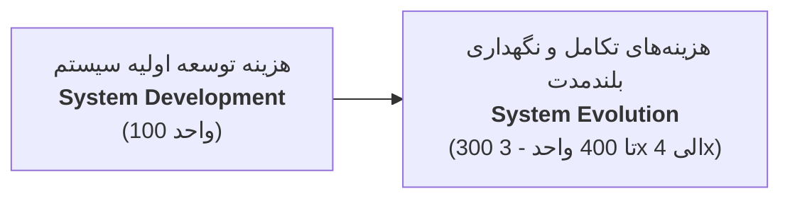
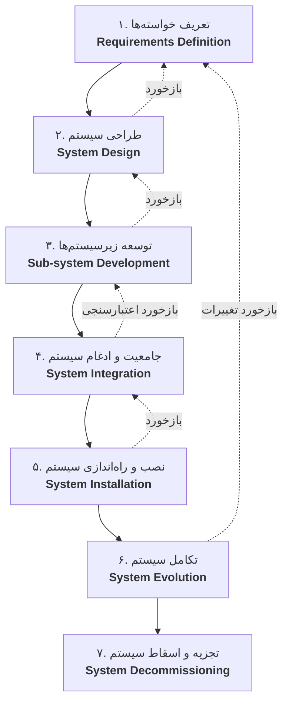
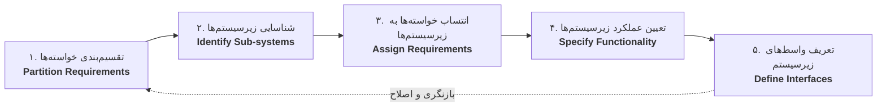
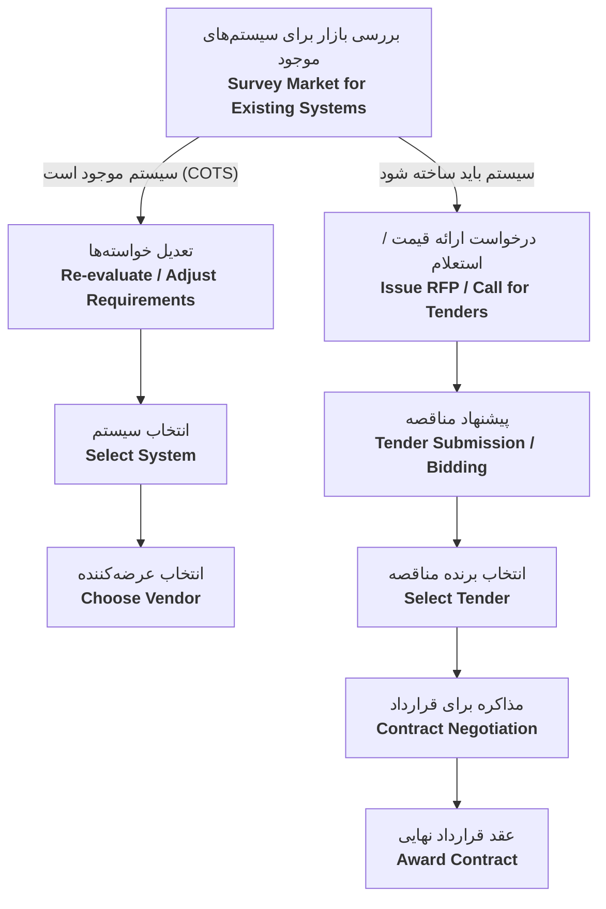
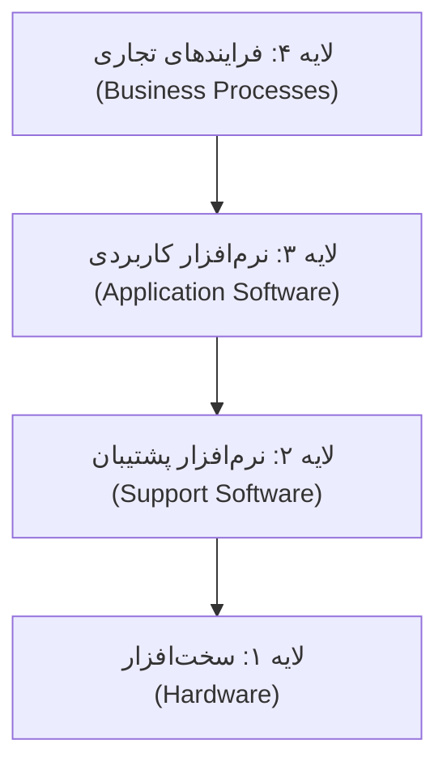

# مهندسی نرم‌افزار ۱ — جزوه خلاصه امتحانی (اسلایدهای ۶ تا ۳۷)
> **درس:** اصول طراحی نرم‌افزار (Software Design Principles)  
> **مرجع اصلی:** فصول ۱ و ۲ مهندسی نرم‌افزار — ایان سامرویل (*Ian Sommerville*)  
> **نوع یادداشت:** منبع مطالعه متمرکز امتحان (Exam Study Source)  
> **پوشه پیوست‌ها:** `attachments/` (شامل تصاویر باکیفیت دیاگرام‌های اسلایدها)

---

## فهرست سرفصل‌ها
1. [[#بخش اول: مبانی مهندسی نرم‌افزار (اسلایدهای ۶ تا ۱۷)]]
   - [[#۱. نرم‌افزار و انواع محصولات نرم‌افزاری (اسلاید ۶)]]
   - [[#۲. تعریف مهندسی نرم‌افزار (اسلاید ۷)]]
   - [[#۳. تفاوت مهندسی نرم‌افزار با علوم کامپیوتر و مهندسی سیستم (اسلاید ۸)]]
   - [[#۴. فرایند نرم‌افزار و فعالیت‌های اساسی آن (اسلاید ۹)]]
   - [[#۵. دیدگاه‌های مدل فرایند نرم‌افزار (اسلاید ۱۰)]]
   - [[#۶. مدل‌های عمومی فرایند نرم‌افزار (اسلاید ۱۱)]]
   - [[#۷. ابزارهای مهندسی نرم‌افزار به کمک کامپیوتر — CASE (اسلاید ۱۲)]]
   - [[#۸. تحلیل هزینه‌های مهندسی نرم‌افزار (اسلایدهای ۱۳ و ۱۴)]]
   - [[#۹. روش‌های مهندسی نرم‌افزار — Methods (اسلاید ۱۵)]]
   - [[#۱۰. ویژگی‌های نرم‌افزار خوب و باکیفیت (اسلاید ۱۶)]]
   - [[#۱۱. اخلاق و مسئولیت‌های حرفه‌ای مهندس نرم‌افزار (اسلاید ۱۷)]]
2. [[#بخش دوم: سیستم‌های اجتماعی-تکنیکی (اسلایدهای ۱۸ تا ۳۷)]]
   - [[#۱۲. سیستم‌های اجتماعی-تکنیکی چیست؟ (اسلایدهای ۱۸ و ۱۹)]]
   - [[#۱۳. خواص و ویژگی‌های برآیند / نوظهور — Emergent Properties (اسلایدهای ۲۰ تا ۲۳)]]
   - [[#۱۴. فرایند مهندسی سیستم در برابر مهندسی نرم‌افزار (اسلاید ۲۴)]]
   - [[#۱۵. مدل فلوچارت فرایند مهندسی سیستم — V-Model (اسلاید ۲۵)]]
   - [[#۱۶. فاز تعریف خواسته‌ها — Requirements Definition (اسلاید ۲۶)]]
   - [[#۱۷. فاز طراحی سیستم و فلوچارت آن (اسلایدهای ۲۷ و ۲۸)]]
   - [[#۱۸. مدل‌سازی و تجزیه زیرسیستم‌ها (اسلاید ۲۹)]]
   - [[#۱۹. پیاده‌سازی و یکپارچه‌سازی زیرسیستم‌ها (اسلاید ۳۰)]]
   - [[#۲۰. تکامل و تجزیه / اسقاط سیستم (اسلاید ۳۱)]]
   - [[#۲۱. عوامل انسانی و سازمانی مؤثر بر طراحی (اسلاید ۳۲)]]
   - [[#۲۲. فرایند تهیه و تدارک سیستم — System Procurement (اسلاید ۳۳)]]
   - [[#۲۳. تعامل فرایندهای تهیه، توسعه و عملیاتی (اسلایدهای ۳۴ و ۳۵)]]
   - [[#۲۴. سیستم‌های کهنه / موروثی — Legacy Systems و پشته لایه‌ای (اسلایدهای ۳۶ و ۳۷)]]

---

# بخش اول: مبانی مهندسی نرم‌افزار (اسلایدهای ۶ تا ۱۷)

### ۱. نرم‌افزار و انواع محصولات نرم‌افزاری (اسلاید ۶)
* **تعریف نرم‌افزار (*Software*):**  
  نرم‌افزار تنها کد یا برنامه‌های کامپیوتری نیست؛ بلکه شامل **برنامه‌های کامپیوتری** به همراه تمام **مستندات (*Documentation*)** و **داده‌های پیکربندی (*Configuration Data*)** مربوطه است که برای عملکرد صحیح و مطلوب برنامه ضروری هستند.
* **دو نوع محصول نرم‌افزاری اصلی:**
  1. **محصولات کلی / عمومی (*Generic Products*):**  
     سیستم‌های مستقلی که توسط سازمان‌های توسعه‌دهنده به صورت عمومی تولید شده و در بازار باز به هر مشتری که تمایل به خرید داشته باشد فروخته می‌شوند (مانند سیستم‌عامل‌ها، بسته‌های آفیس، نرم‌افزارهای CAD، پایگاه‌های داده). کنترل مشخصات در اختیار تولیدکننده است.
  2. **محصولات سفارشی (*Customized / Bespoke Products*):**  
     سیستم‌هایی که به سفارش مستقیم یک مشتری خاص و منحصراً بر اساس نیازها و محدودیت‌های وی توسعه داده می‌شوند (مانند سیستم‌های مانیتورینگ بیمارستان، سیستم کنترل ترافیک هوایی، نرم‌افزارهای رزرو اختصاصی). کنترل مشخصات در اختیار سفارش‌دهنده است.

---

### ۲. تعریف مهندسی نرم‌افزار (اسلاید ۷)
مهندسی نرم‌افزار (*Software Engineering*) یک **نظام مهندسی** است که با تمام جنبه‌های تولید و عرضه محصول نرم‌افزاری، از نخستین مراحل تعیین مشخصات (*Specification*) تا مرحله نگهداری و بازنشستگی (*Retirement*) سروکار دارد.

دو عبارت کلیدی در این تعریف:
1. **نظام مهندسی (*Engineering Discipline*):** استفاده از تئوری‌ها، روش‌ها و ابزارهای نظام‌مند برای حل مسائل با رعایت محدودیت‌های سازمانی، مالی و زمانی.
2. **تمام جنبه‌های محصول نرم‌افزاری (*All Aspects of Software Production*):** علاوه بر فعالیت‌های فنی برنامه‌نویسی و طراحی، جنبه‌های مدیریتی، تضمین کیفیت، مدیریت پروژه و توسعه ابزارهای پشتیبان را نیز در بر می‌گیرد.

---

### ۳. تفاوت مهندسی نرم‌افزار با علوم کامپیوتر و مهندسی سیستم (اسلاید ۸)
* **علوم کامپیوتر در برابر مهندسی نرم‌افزار:**
  * **علوم کامپیوتر (*Computer Science*):** متمرکز بر تئوری‌ها، مبانی ریاضی، نظریه محاسبات و الگوریتم‌های بنیادین است.
  * **مهندسی نرم‌افزار (*Software Engineering*):** متمرکز بر جنبه‌های عملی، مهندسی و تجاری توسعه، تحویل و پشتیبانی نرم‌افزارهای کاربردی و مفید است.
* **مهندسی سیستم در برابر مهندسی نرم‌افزار:**
  * **مهندسی سیستم (*System Engineering*):** با تمام ابعاد سیستم‌های مبتنی بر کامپیوتر شامل توسعه سخت‌افزار (*Hardware*)، نرم‌افزار (*Software*)، و مهندسی فرایندهای سازمانی سروکار دارد.
  * **مهندسی نرم‌افزار:** زیرمجموعه و بخشی از کل فرایند مهندسی سیستم محسوب می‌شود.

---

### ۴. فرایند نرم‌افزار و فعالیت‌های اساسی آن (اسلاید ۹)
مجموعه‌ای ساخت‌یافته از فعالیت‌ها که منجر به تولید یک محصول نرم‌افزاری می‌شوند. ۴ فعالیت اساسی در هر فرایند نرم‌افزار عبارتند از:
1. **تعیین مشخصات نرم‌افزار (*Software Specification*):** تعریف کارکرد، ویژگی‌ها و محدودیت‌های عملیاتی نرم‌افزار با توافق مشتری و تیم مهندسی.
2. **توسعه نرم‌افزار (*Software Development / Design & Implementation*):** تولید معماری، طراحی تفصیلی و پیاده‌سازی و کدنویسی نرم‌افزار.
3. **اعتبار سنجی نرم‌افزار (*Software Validation*):** ارزیابی، تست و بازبینی سیستم برای اطمینان از مطابقت محصول با نیازها و خواسته‌های مشتری.
4. **تکامل نرم‌افزار (*Software Evolution*):** تغییر، به‌روزرسانی و نگهداری نرم‌افزار متناسب با تغییر نیازمندی‌های مشتریان و محیط بازار.

---

### ۵. دیدگاه‌های مدل فرایند نرم‌افزار (اسلاید ۱۰)
مدل‌های فرایند نرم‌افزار از دیدگاه‌های متفاوتی توصیف می‌شوند:
1. **مدل جریان کار (*Workflow Model*):** نمایش توالی و ترتیب فعالیت‌های فرایند به همراه ورودی‌ها، خروجی‌ها و وابستگی‌های بین آن‌ها.
2. **مدل جریان داده یا فعالیت (*Dataflow / Activity Model*):** نمایش فرایند به صورت مجموعه‌ای از فعالیت‌ها که هر یک تبدیلی بر روی داده‌ها انجام می‌دهند.
3. **مدل نقش / کنشگر (*Role / Action Model*):** مشخص‌کننده نقش‌های افراد (مانند مدیر پروژه، برنامه‌نویس، تستر) و وظایف و اقدامات منتسب به هر نقش.

---

### ۶. مدل‌های عمومی فرایند نرم‌افزار (اسلاید ۱۱)
1. **رهیافت آبشاری (*Waterfall Approach*):** مراحل مجزا و متوالی تعیین مشخصات، طراحی، پیاده‌سازی و تست که پس از اتمام هر مرحله وارد مرحله بعد می‌شوند.
2. **توسعه تکاملی (*Evolutionary Development*):** تداخل فازهای مشخصات، توسعه و اعتبارسنجی؛ ساخت یک نسخه اولیه و بازنگری‌های مداوم بر اساس بازخورد کاربر.
3. **تبدیل رسمی (*Formal Transformation*):** ایجاد یک مشخصه ریاضی دقیق و تبدیل گام‌به‌گام و رسمی آن به کد قابل اجرا (بسیار دقیق و مناسب سیستم‌های حساس به ایمنی/حیاتی).
4. **مونتاژ سیستم با قطعات قابل استفاده مجدد (*Reuse-based / CBSE*):** ساخت سیستم با ادغام قطعات و مؤلفه‌های از پیش ساخته شده.

---

### ۷. ابزارهای مهندسی نرم‌افزار به کمک کامپیوتر — CASE (اسلاید ۱۲)
* **تعریف CASE (*Computer-Aided Software Engineering*):**  
  سیستم‌های نرم‌افزاری و ابزارهایی هستند که از فعالیت‌های مختلف فرایند نرم‌افزار به طور خودکار یا نیمه‌خودکار پشتیبانی می‌کنند (مانند ابزارهای رسم دیاگرام‌های تحلیل و طراحی، ژنراتورهای کد، ابزارهای تست خودکار و دیباگرها).

---

### ۸. تحلیل هزینه‌های مهندسی نرم‌افزار (اسلایدهای ۱۳ و ۱۴)

#### اسلاید ۱۳: توزیع هزینه‌ها در مدل‌های توسعه
در روش‌های مختلف تولید نرم‌افزار، سهم هزینه‌ها در مراحل گوناگون تفاوت چشمگیری دارد:

| مدل فرایند | تعیین مشخصات (*Specification*) | طراحی و پیاده‌سازی (*Development*) | تست و جامعیت سیستم (*Integration & Testing*) |
| :--- | :---: | :---: | :---: |
| **مدل آبشاری (*Waterfall*)** | حدود ۲۵٪ | حدود ۲۵٪ | **حدود ۵۰٪** (بیشترین سهم) |
| **توسعه تکراری (*Iterative*)** | حدود ۲۵٪ | **حدود ۵۰٪** (بیشترین سهم) | حدود ۲۵٪ |

```mermaid
%%{init: {'theme':'neutral'}}%%
gantt
    title توزیع درصدی هزینه‌های فرایند نرم‌افزار
    dateFormat  X
    axisFormat %s%%
    section مدل آبشاری (Waterfall)
    تعیین مشخصات (25%)          :0, 25
    طراحی و توسعه (25%)          :25, 50
    جامعیت و تست سیستم (50%)     :50, 100
    section توسعه تکراری (Iterative)
    تعیین مشخصات (25%)          :0, 25
    توسعه تکراری (50%)          :25, 75
    تست سیستم (25%)             :75, 100
```

> [!NOTE] نمودار مرجع اسلاید ۱۳
> ![[slide_13_diagram.png]]

---

#### اسلاید ۱۴: هزینه مبتنی بر قطعه و هزینه‌های تکامل بلندمدت
1. **مهندسی نرم‌افزار مبتنی بر قطعه (*CBSE*):**  
   - تعیین مشخصات: حدود ۲۰٪ تا ۲۵٪  
   - ارزیابی و تطبیق قطعات: حدود ۴۰٪ تا ۵۰٪  
   - جامعیت و تست: حدود ۳۰٪  
2. **مقایسه هزینه توسعه اولیه در برابر تکامل درازمدت (*Evolution*):**  
   - هزینه تکامل و نگهداری نرم‌افزار در طول عمر مفید آن معمولاً **۳ تا ۴ برابر** هزینه اولیه توسعه سیستم است (هزینه توسعه ۱۰۰ واحد در برابر تکامل ۳۰۰ تا ۴۰۰ واحد).

> [!NOTE] نمودار مرجع اسلاید ۱۴
> ![[slide_14_diagram.png]]

---

### ۹. روش‌های مهندسی نرم‌افزار — Methods (اسلاید ۱۵)
روش‌های مهندسی نرم‌افزار رویکردهای ساخت‌یافته‌ای هستند که باید اجزای چهارگانه زیر را در اختیار تیم قرار دهند:
1. **توصیف‌های مدل سیستم (*System Model Descriptions*):** تعاریف و نشانه‌گذاری‌های گرافیکی مدل‌ها (مانند نمودارهای اشیاء، جریان داده، گذار حالت).
2. **قوانین (*Rules*):** محدودیت‌ها و الزاماتی که بر مدل‌های سیستم اعمال می‌شوند.
3. **پیشنهادات (*Recommendations*):** توصیه‌های تجربی و روش‌های بهینه (*Good Practices*) برای اتخاذ بهترین تصمیمات طراحی.
4. **راهنمای فرایند (*Process Guidance*):** دستورالعمل گام‌به‌گام از فعالیت‌های متوالی برای پیشبرد پروژه.

---

### ۱۰. ویژگی‌های نرم‌افزار خوب و باکیفیت (اسلاید ۱۶)
یک سیستم نرم‌افزاری باکیفیت باید ۴ مشخصه اساسی را برآورده سازد:
1. **قابلیت نگهداری (*Maintainability*):** نرم‌افزار باید طوری طراحی و مستند شده باشد که با تغییر نیازهای مشتری، به راحتی قابل اصلاح و گسترش باشد.
2. **قابلیت اتکا (*Dependability*):** شامل اعتمادپذیری (*Reliability*)، امنیت (*Security*) و ایمنی (*Safety*) به طوری که خرابی‌های آن موجب خسارت فیزیکی یا اقتصادی نشود.
3. **کارآمدی / بهره‌وری (*Efficiency*):** عدم اتلاف منابع سیستم شامل چرخه پردازنده، فضای حافظه و پهنای باند شبکه.
4. **قابلیت استفاده (*Usability*):** رابط کاربری و مستندات باید برای کاربرانی که سیستم برای آنها طراحی شده، ساده و قابل فهم باشد.

---

### ۱۱. اخلاق و مسئولیت‌های حرفه‌ای مهندس نرم‌افزار (اسلاید ۱۷)
مهندسان نرم‌افزار باید پایبند به اصول اخلاقی و رفتارهای حرفه‌ای باشند:
1. **محرمانگی (*Confidentiality*):** حفظ رازداری و احترام به اسرار تجاری کارفرمایان یا مشتریان، صرف نظر از وجود یا عدم وجود قرارداد کتبی محرمانگی.
2. **صلاحیت (*Competence*):** عدم پذیرش آگاهانه مسئولیت‌ها یا پروژه‌هایی که خارج از حیطه شایستگی و مهارت حرفه‌ای فرد است.
3. **حقوق مالکیت معنوی (*Intellectual Property*):** آگاهی و پایبندی به قوانین کپی‌رایت، ثبت اختراع، و حق بهره‌برداری از نرم‌افزارها و کدها.
4. **عدم سوءاستفاده از کامپیوتر (*Computer Misuse*):** خودداری از بکارگیری توانایی‌های تخصصی برای رفتارهای مخرب مانند نفوذ غیرمجاز یا آسیب رساندن به سیستم‌های رایانه‌ای دیگران.

---

# بخش دوم: سیستم‌های اجتماعی-تکنیکی (اسلایدهای ۱۸ تا ۳۷)

### ۱۲. سیستم‌های اجتماعی-تکنیکی چیست؟ (اسلایدهای ۱۸ و ۱۹)
* **دسته‌بندی کلی سیستم‌هایی که شامل نرم‌افزار هستند:**
  1. **سیستم‌های کامپیوتری تکنیکی (*Technical Computer-based Systems*):** سیستم‌هایی شامل سخت‌افزار و نرم‌افزار که بدون در نظر گرفتن مستقیم نقش اپراتور انسانی یا فرایند سازمانی کار می‌کنند (مانند سیستم‌عامل، فریم‌ورک‌ها).
  2. **سیستم‌های اجتماعی-تکنیکی (*Socio-technical Systems*):** سیستم‌های جامعی که علاوه بر فناوری (سخت‌افزار و نرم‌افزار)، شامل **افراد (کاربران و اپراتورها)**، **فرایندهای کاری و تجاری**، و **خط‌مشی‌ها و قوانین سازمانی** هستند.

---

### ۱۳. خواص و ویژگی‌های برآیند / نوظهور — Emergent Properties (اسلایدهای ۲۰ تا ۲۳)
* **تعریف ویژگی‌های برآیند (اسلاید ۲۰):**
  1. ویژگی‌هایی که متعلق به **کل سیستم** هستند و از رفتار اجزای منفرد ناشی نمی‌شوند؛ بلکه نتیجه تعامل و اثر متقابل تمام قطعات هستند.
  2. اغلب **غیر قطعی (*Non-deterministic*)** هستند؛ بدین معنا که پیش‌بینی دقیق تمام رفتارهای سیستم دشوار است.
  3. تحقق اهداف سیستم تنها به خود سیستم بستگی ندارد، بلکه به محیط پیرامونی و نحوه تعامل کاربران نیز وابسته است.
* **انواع ویژگی‌های برآیند (اسلاید ۲۱):**
  1. **ویژگی‌های عملکردی (*Functional Properties*):** عملکردهایی که تنها پس از یکپارچه‌سازی تمام اجزای سیستم حاصل می‌شوند (مانند شبیه‌سازی پرواز).
  2. **ویژگی‌های غیرعملکردی (*Non-functional Properties*):** شاخص‌های کیفی سیستم.
* **نمونه‌های شاخص‌های غیرعملکردی (اسلاید ۲۲):**
  1. حجم و اندازه (*Volume / Size*)
  2. قابلیت اعتماد (*Reliability*)
  3. امنیت (*Security*)
  4. قابلیت تعمیر، ترمیم و بکارگیری (*Repairability & Usability*)
* **عوامل مؤثر بر قابلیت اعتماد سیستم (اسلاید ۲۳):**
  قابلیت اعتماد یک سیستم اجتماعی-تکنیکی به ۳ عامل پیوسته بستگی دارد:
  1. **قابلیت اعتماد سخت‌افزار (*Hardware Reliability*):** احتمال بروز نقص فیزیکی در قطعات.
  2. **قابلیت اعتماد نرم‌افزار (*Software Reliability*):** وجود خطاهای منطقی و باگ‌های طراحی و پیاده‌سازی.
  3. **قابلیت اعتماد اپراتور (*Operator Reliability*):** خطاهای انسانی، خستگی، عدم آموزش یا اشتباه کاربران در تصمیم‌گیری.

---

### ۱۴. فرایند مهندسی سیستم در برابر مهندسی نرم‌افزار (اسلاید ۲۴)
* **تعریف فرایند مهندسی سیستم:** مجموعه فعالیت‌های تعیین مشخصات، طراحی، پیاده‌سازی، اعتبارسنجی، استقرار و نگهداری سیستم‌های اجتماعی-تکنیکی.
* **دو تفاوت بنیادین با فرایند توسعه نرم‌افزار:**
  1. **محدودیت شدید برای کار مجدد (*Limited Scope for Rework*):** در مهندسی سیستم، تصمیمات اولیه سخت‌افزاری و زیرساختی گرفته می‌شوند که تغییر دادن آنها پس از پیاده‌سازی به شدت هزینه‌بر یا غیرممکن است (در نرم‌افزار کار مجدد ساده‌تر است).
  2. **پیچیدگی نظام‌های داخلی (*Interdisciplinary Complexity*):** مهندسی سیستم شامل رشته‌های مهندسی گوناگون (الکترونیک، مکانیک، عمران، نرم‌افزار) است و هماهنگی میان آنها دشواری فراوانی دارد.

---

### ۱۵. مدل فلوچارت فرایند مهندسی سیستم — V-Model (اسلاید ۲۵)
فرایند مهندسی سیستم به شکل یک چرخه **V-شکل** مدل‌سازی می‌شود که در آن فازهای سمت چپ با فازهای تست و راه‌اندازی متناظر در سمت راست مرتبط هستند:

> [!NOTE] نمودار مرجع اسلاید ۲۵ (System Engineering Process)
> ![[slide_25_diagram.png]]

---

### ۱۶. فاز تعریف خواسته‌ها — Requirements Definition (اسلاید ۲۶)
تعیین عملکرد، ویژگی‌های اساسی و صفات مطلوب سیستم. خواسته‌ها در ۳ دسته اصلی تعریف می‌شوند:
1. **خواسته‌های عملکردی انتزاعی (*Abstract Functional Requirements*):** کارکردها و خدمات کلی که سیستم باید بدون پرداختن به جزئیات فنی ارائه دهد.
2. **ویژگی‌های سیستم (*System Properties*):** الزامات کیفی مانند عملکرد، دسترسی‌پذیری و قابلیت اطمینان.
3. **خواص نامطلوب / ممنوع (*Undesirable Characteristics*):** رفتارها و شرایطی که سیستم تحت هیچ شرایطی نباید از خود بروز دهد (مانند دسترسی غیرمجاز یا توقف ناگهانی).

---

### ۱۷. فاز طراحی سیستم و فلوچارت آن (اسلایدهای ۲۷ و ۲۸)
* **هدف طراحی سیستم:** مشخص کردن اینکه عملکردهای سیستم چگونه باید به قطعات و اجزای مختلف تخصیص یابند.
* **۵ فعالیت متوالی در فرایند طراحی سیستم (اسلاید ۲۷):**
  1. **تقسیم‌بندی خواسته‌ها (*Partition Requirements*):** تفکیک خواسته‌ها به حوزه‌های سخت‌افزاری، نرم‌افزاری و انسانی.
  2. **شناسایی زیرسیستم‌ها (*Identify Sub-systems*):** تعیین واحدهای عملیاتی مستقل سیستم.
  3. **انتساب خواسته‌ها به زیرسیستم‌ها (*Assign Requirements to Sub-systems*):** نگاشت هر خواسته به زیرسیستم متناظر.
  4. **تعیین عملکرد زیرسیستم‌ها (*Specify Sub-system Functionality*):** مستندسازی وظایف دقیق هر زیرسیستم.
  5. **تعریف واسط‌های زیرسیستم (*Define Sub-system Interfaces*):** تعیین دقیق رابط‌ها و اتصالات برای برقراری ارتباط بدون نقص میان زیرسیستم‌ها.

> [!NOTE] نمودار مرجع اسلاید ۲۸ (System Design Process)
> ![[slide_28_diagram.png]]

---

### ۱۸. مدل‌سازی و تجزیه زیرسیستم‌ها (اسلاید ۲۹)
* در جریان فرایند خواسته‌ها و طراحی، سیستم باید به شکل **مجموعه‌ای از قطعات و پیوندهای بین آنها** مدل‌سازی شود.
* هر زیرسیستم می‌تواند به صورت سلسله‌مراتبی به زیرسیستم‌های کوچک‌تر تجزیه گردد تا زمانی که به قطعات منفرد عملکردی و قابل پیاده‌سازی برسیم.

---

### ۱۹. پیاده‌سازی و یکپارچه‌سازی زیرسیستم‌ها (اسلاید ۳۰)
* **پیاده‌سازی زیرسیستم‌ها (*Sub-system Development*):**  
  زیرسیستم‌های شناسایی شده در مرحله طراحی، به صورت موازی توسط تیم‌های تخصصی مربوطه توسعه می‌یابند.
* **جامعیت زیرسیستم‌ها (*Sub-system / System Integration*):**  
  قطعاتی که به شکل مستقل پیاده‌سازی و تست شده‌اند، در کنار هم قرار گرفته و با یکدیگر یکپارچه می‌شوند تا سیستم یکپارچه نهایی را به وجود آورند.

---

### ۲۰. تکامل و تجزیه / اسقاط سیستم (اسلاید ۳۱)
* **تکامل سیستم (*System Evolution*):**  
  سیستم‌های بزرگ در طول عمر کاری خود مرتباً باید اصلاح شوند تا خطاهای باقی‌مانده رفع شده و پاسخگوی نیازهای جدید کسب‌وکار و محیط باشند. تکامل سیستم پرهزینه‌ترین بخش چرخه حیات است.
* **تجزیه سیستم (*System Decommissioning*):**  
  کنار گذاشتن و از رده خارج کردن سیستم پس از پایان طول عمر مفید عملیاتی آن؛ شامل بازنشستگی سخت‌افزار، انتقال یا آرشیو داده‌های قدیمی و تغییر فرایندهای وابسته.

---

### ۲۱. عوامل انسانی و سازمانی مؤثر بر طراحی (اسلاید ۳۲)
محیط سازمانی تأثیر شدیدی بر موفقیت سیستم دارد. سه عامل اصلی انسانی-سازمانی عبارتند از:
1. **تغییرات فرایند (*Process Changes*):** سیستم‌های جدید نیازمند بازطراحی فرایندهای کاری هستند که ممکن است مقاومت سازمانی ایجاد کند.
2. **تغییرات شغل (*Job Changes*):** نقش‌ها و وظایف افراد در سازمان دستخوش تغییر می‌شود و نیازمند مهارت‌آموزی جدید است.
3. **تغییرات سازمانی (*Organizational Changes*):** ممکن است سیستم ساختار قدرت، سلسله مراتب و روش‌های تصمیم‌گیری در سازمان را تغییر دهد.

---

### ۲۲. فرایند تهیه و تدارک سیستم — System Procurement (اسلاید ۳۳)
فرایند تهیه و خرید سیستم‌های سازمانی، تصمیمی میان خرید سیستم‌های آماده تجاری (*COTS*) یا توسعه اختصاصی از طریق مناقصه است:

> [!NOTE] نمودار مرجع اسلاید ۳۳ (Procurement Process)
> ![[slide_33_diagram.png]]

---

### ۲۳. تعامل فرایندهای تهیه، توسعه و عملیاتی (اسلایدهای ۳۴ و ۳۵)
* **تعریف فرایندها (اسلاید ۳۵):**
  * **فرایند تهیه (*Procurement Process*):** تصمیم‌گیری در خصوص بهترین روش دستیابی سازمان به سیستم و انتخاب مناسب‌ترین تامین‌کننده.
  * **فرایندهای عملیاتی (*Operational Processes*):** فرایندهایی که سیستم در حین کاربری روزمره برای رسیدن به اهداف سازمان اجرا می‌کند.
* **تعامل سه فرایند (اسلاید ۳۴):**  
  فرایند تهیه ورودی‌های خود را به فرایند توسعه می‌دهد، محصول توسعه‌یافته وارد فرایند عملیاتی می‌شود، و بازخوردهای کارکرد عملیاتی به فرایندهای تدارک و توسعه مجدد برمی‌گردند.

> [!NOTE] نمودار مرجع اسلاید ۳۴
> ![[slide_34_diagram.png]]

---

### ۲۴. سیستم‌های کهنه / موروثی — Legacy Systems و پشته لایه‌ای (اسلایدهای ۳۶ و ۳۷)
* **تعریف سیستم‌های کهنه (*Legacy Systems* - اسلاید ۳۶):**  
  سیستم‌های کامپیوتری اجتماعی-تکنیکی هستند که سال‌ها پیش ایجاد شده‌اند و علی‌رغم استفاده از فناوری‌های قدیمی، سازمان هنوز برای انجام عملیات اصلی خود به شدت به آنها وابسته است و جایگزینی آنها با ریسک و هزینه سرسام‌آور همراه است.
* **۶ جزء و قطعه سیستم‌های کهنه:**
  1. **سخت‌افزار سیستم (*System Hardware*):** رایانه‌های قدیمی (مانند مِین‌فریم‌ها) که قطعات یدکی آنها کمیاب است.
  2. **نرم‌افزار پشتیبان (*Support Software*):** سیستم‌عامل‌ها، کامپایلرها و پایگاه‌های داده منسوخ.
  3. **نرم‌افزارهای کاربردی (*Application Software*):** کدهای نوشته‌شده به زبان‌های قدیمی مانند COBOL یا Fortran.
  4. **داده‌های کاربردی (*Application Data*):** داده‌های انباشته‌شده سازمانی که در ساختارهای فایلی خاص ذخیره شده‌اند.
  5. **فرایندهای تجاری (*Business Processes*):** روال‌های کاری که در سازمان حول رفتار این سیستم قدیمی شکل گرفته است.
  6. **قوانین و سیاست‌های تجاری (*Business Rules & Policies*):** ضوابط تعبیه‌شده در نرم‌افزار که ممکن است دیگر هیچ مستند کتبی معتبری برای آنها وجود نداشته باشد.

---

#### پشته لایه‌ای سیستم‌های کهنه و اجتماعی-تکنیکی (اسلاید ۳۷)
مدل لایه‌ای نشان می‌دهد که فرایندهای تجاری در بالاترین لایه قرار دارند و هر لایه به خدمات لایه‌های زیرین متکی است:

| شماره لایه | نام لایه سیستم | توضیح عملکردی |
| :---: | :--- | :--- |
| **لایه ۴** | **فرایندهای تجاری (*Business Processes*)** | رویه‌ها، قواعد سازمانی و فعالیت‌های کسب‌وکار |
| **لایه ۳** | **نرم‌افزار کاربردی (*Application Software*)** | برنامه‌ها و کدهای پیاده‌سازی‌کننده عملکردهای تجاری |
| **لایه ۲** | **نرم‌افزار پشتیبان (*Support Software*)** | سیستم‌عامل، سیستم مدیریت پایگاه داده، فریم‌ورک‌ها |
| **لایه ۱** | **سخت‌افزار (*Hardware*)** | سرورها، پردازنده‌ها، شبکه‌ها و دستگاه‌های ذخیره‌سازی |

> [!NOTE] نمودار مرجع اسلاید ۳۷ (Legacy System Layers)
> ![[slide_37_diagram.png]]

---
## خلاصه نکات پرکاربرد امتحانی (Cheat-Sheet)
1. **تفاوت محصول عمومی و سفارشی:** در محصول عمومی کنترل مشخصات دست تولیدکننده است؛ در سفارشی دست مشتری.
2. **سهم تست در مدل آبشاری:** حدود ۵۰٪ کل هزینه‌ها.
3. **نسبت هزینه تکامل به توسعه:** تکامل معمولاً ۳ الی ۴ برابر هزینه توسعه اولیه است.
4. **تفاوت مهندسی سیستم با نرم‌افزار:** محدودیت شدید کار مجدد (به خاطر سخت‌افزار) و پیچیدگی نظام‌های چندرشته‌ای.
5. **ویژگی‌های برآیند (*Emergent Properties*):** متعلق به کل سیستم هستند نه تک‌تک قطعات؛ اغلب غیرقطعی‌اند.
6. **۳ رکن قابلیت اعتماد سیستم:** قابلیت اعتماد سخت‌افزار + نرم‌افزار + اپراتور انسانی.
7. **اجزای سیستم کهنه (*Legacy*):** سخت‌افزار، نرم‌افزار پشتیبان، نرم‌افزار کاربردی، داده‌ها، فرایندهای تجاری، سیاست‌ها و قوانین تجاری.
