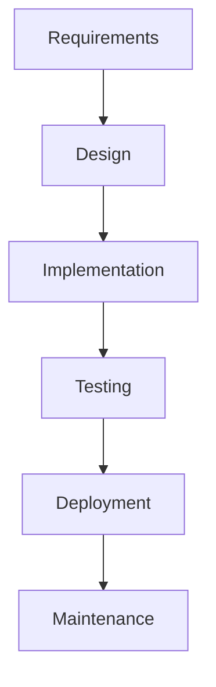
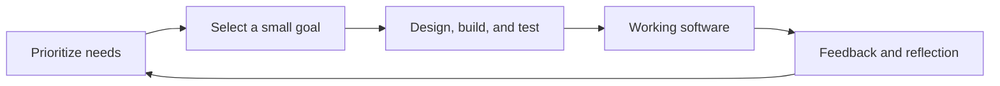

# Software Design Principles

## Main ideas
- Lecture topics: What is software? How does software development flow?
- Software tells a computer what to do and helps users perform tasks or solve problems.
- Hardware is the physical equipment; software provides the instructions that run on it.

### Supporting study notes
The explanations below are study aids, not a verbatim record of the instructor's wording.

- Software includes programs and associated data, configuration, and documentation needed to operate and maintain them.
- Software design describes how a software system's parts are organized and how they interact.

## Software development life cycle (SDLC)

The SDLC describes the work involved in creating and maintaining software. A development model determines how that work is ordered, repeated, and reviewed. The following are supporting study notes; the instructor's exact list of models is still to be confirmed.

### Common activities

| Activity | Question it answers | Room booking example |
| --- | --- | --- |
| Planning and feasibility | Why build it, and can we? | Identify campus needs, budget, and constraints. |
| Requirements and analysis | What must it do? | Students reserve rooms; overlapping reservations are rejected. |
| Design | How will its parts work together? | Define screens, reservation rules, interfaces, and data structures. |
| Implementation | How do we build it? | Write the availability and booking code. |
| Testing | Does it behave correctly and meet needs? | Check overlapping bookings, cancellations, and permissions. |
| Deployment | How do users get it? | Release it for campus use. |
| Operation and maintenance | How do we keep it useful? | Monitor failures, fix bugs, and change rules. |

These activities can overlap or repeat. Testing and security work should occur throughout development, even when a simplified diagram shows a separate testing phase.

### 1. Waterfall: sequential phases

**Flow:** Requirements → Design → Implementation → Testing → Deployment → Maintenance.

Work moves through planned phases, generally completing and approving a phase before proceeding. It suits relatively stable requirements. Its limitation is late feedback from working software; changes can cause substantial rework. [SDLC overview](https://www.ibm.com/think/topics/sdlc).

**Example:** Document booking, cancellation, and administrator rules first. Design the complete system, implement it, and then perform integrated testing before release. If users later request recurring bookings, reconsider the affected requirements, database, interface, and tests.

**Remember:** Changes are possible, but returning to earlier decisions may be costly.

### 2. V-model: pair development with testing

**Flow:** Define needs → Specify requirements → Design architecture → Design components → Code → Unit tests → Integration tests → System tests → Acceptance tests.

The V-model relates development decisions to corresponding test levels, with test planning beginning early. Its strength is traceability; its limitation is the difficulty of accommodating major changes in a sequential process. [Software development overview](https://www.ibm.com/think/topics/software-development).

| Development decision | Corresponding test level | Example check |
| --- | --- | --- |
| User needs | Acceptance testing | Can a student successfully reserve a suitable room? |
| System requirements | System testing | Does the complete application prevent overlapping bookings? |
| Architecture and interfaces | Integration testing | Does the booking component correctly communicate with storage? |
| Component design | Unit testing | Does the time-overlap function handle boundary cases? |

Exact phase names vary between versions of the model. Tests on the right side assess decisions made on the left side; they are not simply a second pass through identical activities.

### 3. Iterative development: improve through repeated cycles

**Flow:** Initial version → Evaluate → Revise requirements/design → Implement and test improvements → Evaluate again → Repeat.

Iteration means revisiting and refining work using feedback. Its strength is learning early; its challenge is controlling repeated rework and preserving a coherent design. [IBM's iterative development documentation](https://www.ibm.com/docs/en/engineering-lifecycle-management-suite/workflow-management/7.2.0?topic=scenarios-iterative-development).

**Example:** Build a basic booking screen, observe students using it, simplify the date selector, then improve error messages in another cycle. The same feature becomes better across versions.

### 4. Incremental development: deliver functionality in parts

**Flow:** Prioritize features → Design/build/test the first usable slice → Deliver → Add another usable slice → Integrate and test → Repeat.

An increment adds capability. An iteration refines capability. A project can do both: release a new cancellation feature while improving the existing booking screen. [IBM's lifecycle testing overview](https://community.ibm.com/community/user/viewdocument/testing-throughout-the-software-lif?CommunityKey=3d7261ae-48f7-481d-b675-a40eb407e0fd&hlmlt=BL&tab=librarydocuments).

**Example increments:**

1. View rooms and availability.
2. Reserve a room.
3. Cancel a reservation.
4. Join a waiting list.

**Advantage:** Users receive useful functionality before the entire system is complete.

**Limitation:** Each addition must fit the existing design; poor interfaces can make integration difficult. A usable slice normally includes its necessary interface, logic, storage, and tests, rather than delivering only an unfinished technical layer.

### 5. Spiral: let risk guide each cycle

**Flow:** Set objectives and alternatives → Analyze and reduce risks → Develop and verify → Review and plan the next cycle → Repeat.

Spiral development organizes repeated cycles around risk. It suits projects with significant uncertainty, but requires risk-analysis expertise and adds management effort. [SDLC overview](https://www.ibm.com/think/topics/sdlc).

**Example:** The greatest uncertainty is whether simultaneous requests can double-book a room. Before building every screen, test a small implementation of reservation locking under concurrent requests. Use the results to choose the design for the next cycle.

**Remember:** A cycle may produce a prototype, an experiment, or production functionality, depending on the risk being addressed.

### 6. Prototyping: clarify needs with an early model

**Flow:** Identify uncertain needs → Build a prototype → Gather user feedback → Refine → Confirm requirements → Develop the production system.

A prototype makes an idea concrete so people can evaluate it. It may be a paper sketch, clickable interface, or partial implementation.

- **Throwaway prototype:** Learn from it, then discard it and build the real system.
- **Evolutionary prototype:** Gradually develop it into the real system, strengthening its design and quality as it grows.

**Example:** Show students a clickable booking calendar before deciding how room selection should work.

**Advantage:** Reveals misunderstandings and usability issues early.

**Limitation:** A convincing demo can create unrealistic expectations; it may lack secure access, reliable storage, or complete error handling. Prototyping supports other development models too. [RAD and prototyping overview](https://www.ibm.com/think/topics/rapid-application-development).

### 7. Rapid Application Development (RAD)

**Flow:** Requirements planning → User design with repeated prototypes → Construction → Cutover (final preparation and introduction into use).

RAD emphasizes fast development with close user participation, prototypes, and reusable tools or components. It works well when users are available to give frequent feedback and the application can be built in manageable parts.

**Example:** Quickly prototype a campus administrator dashboard, refine it with staff, then build and introduce the agreed functions.

**Advantage:** Short feedback cycles can speed up delivery.

**Limitation:** Speed can crowd out architectural work and documentation unless the team deliberately maintains them. [RAD overview](https://www.ibm.com/think/topics/rapid-application-development).

### 8. Agile: adapt through delivery and feedback

**Typical flow:** Prioritize needs → Select a small goal → Design/build/test → Deliver or demonstrate working software → Gather feedback → Adjust priorities → Repeat.

Agile is a set of values and principles, rather than one mandatory sequence of phases. It emphasizes collaboration, useful software, responding to changing needs, and improving how the team works. Iterative and incremental development commonly support it. [Agile principles](https://agilemanifesto.org/principles.html).

**Example:** Deliver basic reservations first. Feedback shows that cancellations matter more than room photos, so prioritize cancellation next.

**Advantage:** Frequent feedback helps the team adapt to changing needs.

**Limitation:** It requires sustained collaboration, clear priorities, and technical discipline. Agile still involves planning, design, testing, and documentation; those activities evolve with the project.

#### Scrum: an Agile framework with Sprints

**Flow:** Ordered Product Backlog → Sprint Planning → Work toward a Sprint Goal → Sprint Review → Sprint Retrospective → Next Sprint.

A Sprint lasts one month or less. During it, Developers hold a Daily Scrum to inspect progress and adapt their plan. The team produces usable work that meets its Definition of Done. A Sprint Review gathers feedback; a Retrospective improves how the team works. Releases can happen before the Sprint ends. [Scrum Guide](https://scrumguides.org/scrum-guide.html).

- **Product Owner:** Accountable for product value and effective Product Backlog management.
- **Scrum Master:** Accountable for establishing Scrum and helping improve the team's effectiveness.
- **Developers:** Create the usable product Increment.

**Example Sprint Goal:** Students can book an available room and receive confirmation.

**Strength:** A regular rhythm for inspection and adaptation.

**Challenge:** Completing disconnected tasks without a shared goal or a usable result weakens the framework.

#### Kanban: manage continuous flow

**Example workflow:** Ready → In progress → Review/testing → Done.

Visualize work, limit work in progress (WIP), and pull new tasks when capacity becomes available. Inspect bottlenecks and improve flow. Kanban does not require Sprints and can also complement Scrum. [Atlassian's WIP guidance](https://www.atlassian.com/agile/kanban/wip-limits/).

**Example:** Limit “In progress” to two tasks. If both slots are occupied, help finish existing work before starting another feature.

**Strength:** Makes blocked work and overload visible.

**Challenge:** A board alone does not establish good flow; the team needs explicit policies and must act on bottlenecks.

### Quick comparison

| Approach | Main organizing idea | Key thing to remember |
| --- | --- | --- |
| Waterfall | Sequential phases | Define and plan extensively before building. |
| V-model | Development/test correspondence | Plan how to test each level of the design. |
| Iterative | Repeated refinement | Improve what already exists. |
| Incremental | Added functionality | Deliver useful parts over time. |
| Spiral | Risk-driven cycles | Address the greatest uncertainty first. |
| Prototyping | Learning from an early model | Make unclear needs visible. |
| RAD | Rapid construction and user feedback | Use prototypes and tools to accelerate delivery. |
| Agile | Feedback and adaptation | Adjust plans as you learn. |
| Scrum | Sprint goals and usable Increments | Inspect product and teamwork regularly. |
| Kanban | Continuous flow and WIP limits | Finish work and manage bottlenecks. |

### Important distinctions

- These approaches can overlap: an Agile project can be iterative and incremental, use prototypes, and apply Kanban practices within Scrum.
- A development flow describes how the team works. A **DFD (Data Flow Diagram)** describes how data moves within a system; it serves a different purpose.
- The semester assignment is cumulative. Whether it is iterative, incremental, or both depends on whether weekly tasks refine earlier work, add new material, or do both.

## Definitions and formulas
- **Software:** computer programs together with their associated data and documentation.
- **Program:** a set of instructions that a computer can execute.
- **Hardware:** the physical components of a computer system, such as its processor, memory, and keyboard.
- **System software:** software that manages computing resources or supports other software, such as an operating system.
- **Application software:** software that performs tasks for users, such as a browser or a booking application.

## Examples
- A laptop's keyboard and processor are hardware; its operating system and browser are software.
- In a room booking application, software checks availability, records reservations, and displays confirmation to the user.

## Questions to resolve
-

## Recall questions
- What are the main ideas?
- Can I explain the key terms without looking?
- What is software, and what does it include besides program code?
- How does software differ from hardware?
- What is the difference between system software and application software?
- What are the common SDLC activities, and how does Waterfall order them?
- Why can late requirement changes cause rework in Waterfall?
- How does the V-model connect design decisions to test levels?
- What is the difference between an iteration and an increment? Give a booking-system example of each.
- What determines the next cycle in the Spiral model?
- How do throwaway and evolutionary prototypes differ?
- How does RAD use user feedback and prototypes?
- Why is Agile more than simply working in short cycles?
- How do Scrum's Sprint Review and Retrospective differ?
- How do Kanban's WIP limits help a team finish work?

## After-class summary
Write a short explanation from memory, then check it against the lecture material.

## Related concepts
-

## Assignment
- [[01 Courses/Software Design Principles/Assignments/Semester Presentation Project|Semester Presentation Project]]: choose one subject and extend it through weekly assignments throughout the semester.
